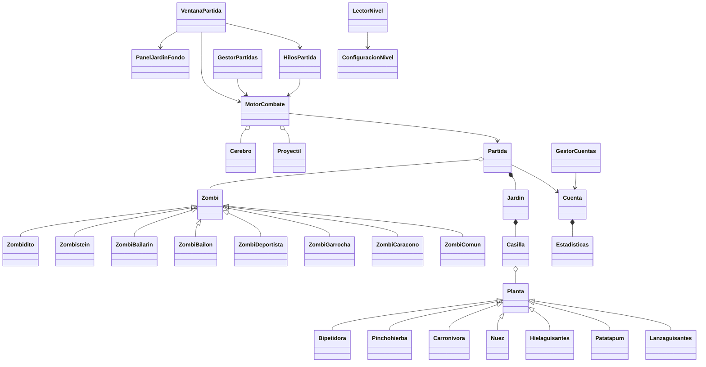

# Guía técnica de los cambios

## Organización

- `principal`: arranque en el hilo de eventos de Swing (`Proyecto2_PlantasVsZombies` y `Juego`).
- `vista`: ventanas, dibujo del jardín y entrada del usuario. Solo estas clases manejan Swing.
- `modelo`: estado de cuenta y partida, jardín, casillas, proyectiles, cerebros y motor.
- `plantas` y `zombis`: jerarquías de entidades. Sus métodos sobrescritos resuelven escudos, inmunidad y otras diferencias.
- `archivos`: lectura JSON, cuentas/estadísticas, rutas portables y partidas binarias.

## Tiempo e hilos

`HilosPartida` crea un hilo de reloj y un Thread por generador: 6 en Fácil, 5 en Medio y 4 en Difícil. Cada trabajador espera 40 ms y publica una tarea con `SwingUtilities.invokeLater`. El reloj solicita el fotograma; el generador i solicita `actualizarGenerador(i)`.

Todos los accesos al modelo y a la interfaz ocurren en el EDT. Los trabajadores no leen ni escriben dinero, salud, posiciones, pausas o temporizadores. En el EDT se valida la sesión de cada tarea, de modo que las entregas antiguas se descartan después de pausar o cerrar.

Pausar interrumpe los trabajadores. Reanudar conserva el estado y las fechas, reinicia el instante del fotograma y crea una sesión nueva. Guardar, finalizar o cerrar también los detiene. No se usan Timer, volatile, synchronized, wait/notify ni java.util.concurrent.

Cada generador conserva su fecha `proximoCerebro[i]` en tiempo de juego. Espera 5–15 s, crea un icono y espera a que se recoja o venza antes de programar otra espera. El indicador de generadores externos es transient: no se serializan trabajadores y no hay doble emisión. El modo interno permite pruebas sin ventanas.

La ventana usa System.nanoTime y limita cada paso a 0.15 s, aplicándolo al contador y al motor por igual. Si la máquina se bloquea, se ralentiza la simulación en lugar de saltarse el combate.

## Coordenadas y combate

La posición horizontal se mide en columnas y el centro del zombi es `posicionX + 0.35`. Su casilla lógica es `floor(posicionX + 0.35)`, limitada a los bordes del jardín. El panel convierte estas unidades a píxeles según su tamaño.

Un zombi avanza a `0.44 × modificadorVelocidad` columnas por segundo. Se detiene a `columnaPlanta - 0.30` para morder. El motor trata Pinchohierba como transitable, Garrocha como salto de una sola oportunidad y Zombistein como aplastamiento. La Nuez impide el salto y consume la garrocha.

Los proyectiles viajan a 3 columnas/s. En cada paso se considera el segmento entre su posición anterior y la nueva, con un margen de 0.14. Se selecciona el primer zombi vivo del mismo carril que intersecte ese segmento. Después del impacto se elimina el proyectil. El hielo fija una fecha de vencimiento a 4 s y multiplica la velocidad por 0.6; otro impacto renueva la fecha sin acumular reducción.

Patatapum se activa 10 s después de su creación, incluida la siembra de la IA. Carroñívora bloquea sus ataques mientras digiere 8 s. Pinchohierba aplica daño a todos los zombis de su casilla cada 0.5 s. Los ataques de área usan la casilla lógica anterior, nunca estimaciones de píxeles.

Cada carril empieza con una podadora. La primera llegada elimina a todos los zombis vivos de ese carril, consume la podadora y activa su animación. La siguiente llegada en ese carril termina en victoria. Al llegar el contador a cero se termina en derrota.

## Dificultad

Fácil no siembra. Medio evalúa cada 10 s, elige una planta al azar y busca una casilla desde la columna más cercana a la casa, con desempate por fila de arriba hacia abajo.

Difícil evalúa cada 5 s. Recorre todas las entidades para una regla antes de pasar a la siguiente: peligro cerca de casa, planta superada, resistente, deportista, garrocha, grupo de más de tres, defensa por defecto. Solo ejecuta una acción por evaluación. Si no hay destino válido para una regla, continúa con las demás. La defensa por defecto usa el carril con menos defensas que tenga espacio y la casilla libre más cercana a la casa.

## Hordas y contadores

El bloque es `1 + floor((duracionTotal - tiempoRestante + fraccionReloj) × 7 / duracionTotal)`, con límite 7. En el bloque 4 se cobra la mitad; en el 7, la cuarta parte. Se redondean costos hacia arriba cuando no son enteros. Las compras incrementan los contadores de zombis comprados y cerebros gastados; las invocaciones de otros zombis no los incrementan.

## Archivos

`LectorNivel` lee mediante `java.io` y analiza caracteres con un cursor. Consume las claves en el orden del enunciado, enteros, corchetes, comas y cadenas. Construye arreglos nativos que crecen duplicando capacidad, y luego los recorta a su tamaño exacto. Rechaza filas desiguales, plantas desconocidas, estructuras vacías y texto sobrante.

Cada carpeta de cuenta contiene `estadisticas.txt` y `partidas/`. Las carpetas nuevas usan el prefijo `u-` y cuatro dígitos hexadecimales por carácter del nickname. Así el sistema de archivos no confunde diferencias de mayúsculas. Se conserva la lectura de carpetas anteriores.

`estadisticas.txt` tiene ocho líneas `Etiqueta: número`, con partidas jugadas, ganadas, perdidas, plantas destruidas, zombis comprados, cerebros gastados, mejor tiempo y podadoras. Al finalizar se actualiza una sola vez y se escribe primero un temporal. Los rankings se ordenan por inserción sobre arreglos; no se usan Collections. Los empates se ordenan por nickname; las cuentas sin victoria se excluyen del ranking de rapidez.

El binario contiene un `GestorPartidas.Estado` con versión, motor y fracción de segundo. El motor referencia la partida y todas las entidades, sus estados y fechas pendientes. No se serializan ventanas, hilos ni conexiones. El nombre usa fecha/hora con milisegundos. Primero se completa un archivo temporal y después se renombra; si falla, el usuario sigue en pausa y puede intentarlo de nuevo. Al cargar se filtran las clases admitidas y los tamaños, se comprueba la cuenta, se vincula su objeto actual y se impone pausa antes de mostrar el tablero.

## Alcance visual

El JAR incluye las 34 imágenes de Imagenes.zip, con sus fondos y sprites originales. Las plantas y los seis zombis del catálogo utilizan esas imágenes; los dibujos vectoriales solo se usan cuando falta un sprite. Los brazos y escudos cambian con el estado; la Nuez muestra grietas; Patatapum muestra preparación/activación; Carroñívora indica digestión. Se representan salto, baile, lanzamiento aéreo de Zombidito y aplastamiento. Puedes reemplazar los marcadores por tus recursos originales sin cambiar las reglas del modelo.

Actualización visual: se priorizan los sprites disponibles, con las ocho variantes adicionales incluidas para escudos, arma, brazo, lanzamiento y zombis generados; el respaldo vectorial solo se usa cuando falta un archivo. Menú y selección recuperan Fondo2.jpg y Fondo4.jpg, respectivamente.

## Manuales completos

Ver `documentacion/Manual_tecnico.pdf` y `documentacion/Manual_de_usuario.pdf`. Incluyen UML, ciclo de vida de trabajadores, formatos y capturas reales de todos los flujos.
